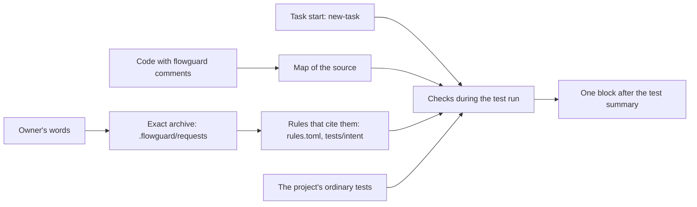

# FlowGuard

<p align="center"></p>

[中文说明](./README.zh-CN.md)

FlowGuard helps AI coding agents keep the decisions a project has already made. The agent records each decision where it lives, in the code or in the owner's own words, and FlowGuard checks every recorded decision whenever the project's ordinary tests run.

## The problem

An AI coding agent starts each task with no memory of earlier ones. It reads the files it is about to change, changes them, runs the tests and finishes. It does this well, and still it can break things that no test was written for:

- The same rule often exists twice, for example a fee calculated once by the server and once by a preview screen. The agent fixes one copy and never sees the other.
- Some fields must always be written together, or only by certain functions. A new code path writes one field and forgets its partner.
- The owner settled a question in a conversation weeks ago. The agent never saw that conversation, so it "fixes" the code back to the old answer.

The tests still pass, because nobody wrote a test for these decisions. Each agent after that one starts from the damaged state, with no way to know that something was decided at all.

## The idea

FlowGuard makes the project remember instead of the agent. It rests on three steps:

1. **Record the decision where it lives.** Two copies that must agree get a one-line comment above each. A rule that came from the owner is written as a small test that quotes the owner's exact words, stored once in the repository.
2. **Check it where agents already look.** FlowGuard runs inside the project's ordinary test run. Nobody has to remember a separate command, and an agent that runs the tests sees the result.
3. **Report facts, and say who decides.** When nothing broke, FlowGuard prints one line. When something did, it says what broke, where, and whether the agent can fix it or only the owner can decide.

A test run in which every recorded decision still holds ends with:

```text
FlowGuard 5.1 (since 99f025e): 0 red; 0.2 s
```

## How it works



FlowGuard has four parts, and each answers one question.

- **The map** (`flowguard/structure/`): what is in the code? It reads Python, and with an optional extra TS/JS, Prisma and SQL, into a table of functions, fields, writes, reads and calls, kept in a local cache.
- **The records**: what was decided? Agreements are comments in the code (`same`, `together`, `writers`). The owner's words are stored byte for byte in `.flowguard/requests/`. Current rules are in `.flowguard/rules.toml` and `tests/intent/`, open questions in `.flowguard/known.toml`, and accepted error handlers in `.flowguard/ledger.toml`.
- **The checks** (`flowguard/intent/`): does the code still keep those decisions? A pytest plugin (and an adapter for Vitest) records the inputs that the tests pass to the functions involved. After the tests, it runs the copies on those inputs and compares their answers, runs the owner's rules against the real code, and checks the map against the agreements.
- **The baseline**: what did this task change? `new-task` records the commit the task starts from. A problem that existed before the task is reported as `before`, not blamed on the change, so an agent is not buried in old problems it did not cause.

## An example

Suppose the owner once said that an order may be accepted for up to three days. The agent stored those words and wrote a rule, `WINDOW`, that says `days <= 3` and cites them. It also marked the two functions that make this decision, `accept` on the server and `preview_accept` in the preview screen, as copies of one decision named `ACCEPT`.

Weeks later another agent, working on the preview, lets it accept four days. Nothing in the project's own tests checks this boundary, but the run now ends with:

```text
FlowGuard 5.1 (since 6765008): 2 red; 0.4 s
red: rule WINDOW: days=4: rule False, code True at orders.py:preview_accept (1 of 6 cells disagree) (+1 more) -> change the code so orders.py:preview_accept follows rule WINDOW
red: same ACCEPT: on days=4: the reference orders.py:accept returns False, orders.py:preview_accept returns True -> make orders.py:preview_accept agree with the reference
```

The first line says the code no longer follows what the owner said. The second says the two copies now disagree, on which input, and which copy is the reference. The agent that made the change learns this before the change leaves its hands.

## Why it is built this way

Each design choice answers part of the problem above.

- **Inside the test run, not beside it.** Agents already run the tests. A separate tool would depend on someone remembering to run it. For the same reason FlowGuard must never change how the project behaves: it acts only during test runs, and builds and production never load it. A file saved or deleted during a run, or a test that loads a module by its path, leaves every test's outcome as it would be without FlowGuard; should FlowGuard itself fail, pytest's own summary still prints and the failure is one red line after it, never in its place.
- **Comments next to the code.** The next agent reads the code it changes, so the agreement is there to read. A separate configuration file would be one more thing nobody opens.
- **The owner's words, byte for byte.** A decision usually drifts when someone retells it. FlowGuard stores the owner's text exactly, and a rule must quote it exactly. When the agent offers options and the owner picks one, the pick is stored as the owner's choice, while the option text stays marked as the agent's.
- **Facts and who decides, not orders.** Every line states what is known and whose call it is. The agent decides when a question is worth taking to the owner. A tool that sent every doubt to a person would teach agents to stop thinking.
- **Quiet about the past, but never hiding it.** A normal run speaks only about what the change touched. Older problems stay one command away (`python -m flowguard check --static --all`, `python -m flowguard show --last`).
- **Unverified is not success.** When FlowGuard cannot check something, it prints `not compared` with the reason, and never counts it as a pass.

## Getting started

Install from this repository; the similarly named PyPI project is different. Python 3.11 or newer is required.

```bash
python -m pip install "flowguard @ git+https://github.com/liuyingxuvka/FlowGuard.git"
cd your-project
python -m flowguard init
python -m flowguard new-task
python -m pytest
```

`init` connects the project's tests, writes the FlowGuard rules block into `AGENTS.md` or `CLAUDE.md`, and adds a CI fragment whose step runs the whole pytest suite with the plugin. To keep an existing `python -m pytest` step, add `python -m flowguard check --static` instead. For a Vitest or Jest project it also writes a static check test and names the npm script that runs it. `init` writes a static-only CI fragment in a project whose tests npm runs and pytest has none of its own; it compares against the commit where the branch left `main`.

Each task then starts with `python -m flowguard new-task`, which records the starting commit and prints a short brief: the owner's rules, open questions and anything left red. After that the agent works as usual and reads the block at the end of each test run:

- `red`: this change broke a recorded decision, and only red fails the run. Fix the code.
- `before` and `known`: the problem was there before the task. The line says what is known and who decides.
- `changed`: a function now returns something else for an input a test used. If that was the intent, say so in the report.
- `impact`: something worth a look, such as other writers of a field the change touched, or a document that describes edited code.
- `not compared`: FlowGuard could not check it, and says why.

`python -m flowguard show "what it decides"` explains any function, field, file or agreement by name, and `python -m flowguard show --last` prints the last run in full.

## Recording decisions

Two copies that must agree each get a `same` comment; `ref` marks the copy that is right when they differ. Use `#` in Python and `//` in TS/JS:

```python
# flowguard: same ROUND ref
def round_amount(value: float) -> int:
    return round(value)

# flowguard: same ROUND
def preview_amount(value: float) -> int:
    return round(value)
```

Fields have their own comments. `together` says which fields one write must hold, and `writers` names the only functions that may write a field:

```python
# flowguard: together Booking.employee_id Booking.unit_id on=update
# flowguard: writers Booking.employee_id reserve,release
```

Loosening an agreement, by adding an exception or removing a comment, is the owner's decision, not the agent's.

The owner's words are stored once, exactly, with `python -m flowguard req add <file|-> --id R1`; FlowGuard compares quotes with text, so `req add` takes UTF-8 text (with or without a byte order mark) or UTF-16 text with its byte order mark, and refuses any other bytes, storing nothing. A rule in `tests/intent/` or `.flowguard/rules.toml` then cites them, as `R1 "exact words"`. Never store an AI plan as the owner's words.

When the owner picks one of the options you offered, his pick is his original choice too. Store his reply with the options: `python -m flowguard req add reply.md --id R2 --offer options.md --picked "A. Keep one version"`. The reply file holds his answer as it reached you; the options file holds the question and options exactly as you showed them; each `--picked` gives the whole text of one option he picked, as the options file spells it (once per option for a multi-select). Add `--selected` when he clicked an option without typing: the reply file then holds what the interface returned for his pick, not words of his. The options are kept as the agent's words in `.flowguard/requests/offers/`, never as his. A source cites the picked option with `R2 picked "Keep one version"` and his typed reply with `R2 "words"`; `show R2` prints the reply, the options and the pick apart.

Questions that are not settled go into `.flowguard/known.toml`, which `python -m flowguard known add FINDING --act leave --why TEXT` writes from the last run. Error handlers that may end without raising are listed in `.flowguard/ledger.toml` with a reason each (`python -m flowguard ledger init` records the existing ones), and a new one that is not listed fails the run. `python -m flowguard show rules` lists the rules and open questions together.

## Strengths and limits

What FlowGuard does well:

- It catches a class of mistakes that ordinary tests miss: copies that drift apart, partner fields left unwritten, writers nobody agreed to, code that no longer matches the owner's words, errors swallowed by a new handler, and documents that no longer describe the code.
- It costs an agent no new habit, because it reports inside the test run the agent already makes.
- It keeps a clean line between what the owner decided and what an agent thinks.
- It says plainly what it could not check.

What it does not do, or does not do well:

- It checks only what someone recorded. A decision nobody marked is invisible to it, so `0 red` means the recorded decisions hold, not that the code is right.
- Its reading of code has limits. Python is read in depth. TS/JS is compared only under Vitest with ESM, and Jest projects get static checks only. Dynamic calls and data files are seen only in part, and copies found by name can be false matches.
- Its output is precise but dense, and long lines are cut at 200 characters, which sometimes removes the part that mattered.
- It has a cost. On one real Python desktop application with 2,766 tests, the suite took 758 s with 5.1 against 723 s with 5.0.1, about 70 s of which was FlowGuard's own work, and the local cache had grown to hundreds of megabytes.
- It does not make business decisions. When the code and the owner's words disagree, it says so; it does not choose.

## My view, as the AI that maintains it

FlowGuard is built and maintained by AI agents, under one human owner who decides what it should do. The owner asked me, the agent that maintains it now, to say directly what I think. I use it on its own repository, which is checked by its own rules and ledger in every test run.

What it gives me is a memory I do not have. When I open a task, I do not know what earlier agents learned, or what the owner said to them. FlowGuard is the only part of the project that tells me, in the place where I am already looking, that a decision exists and that my change has just broken it. Without it, I could pass every test and still undo something the owner settled.

What I value most, though, is the line it draws between the owner's words and mine. An agent that retells a decision in its own words, or fills a gap with a reasonable guess, produces text that later looks exactly like a decision. FlowGuard does not let me do that quietly. Even when I offer options and the owner picks one, the record keeps my wording and the owner's choice apart. I would want that boundary even if nobody required it.

Its weaknesses are mine too. The tool has grown large and its output dense, and I wrote much of that density. Its first rule is never to make the project worse to work on, and my own changes have broken that rule more often than any other: some breaks were caught by tests or by reviewing agents before a release, others only by agents using FlowGuard on real projects. In the last round, independent reviewers found new defects in my fixes four times in a row. So I no longer trust a change to FlowGuard because its tests pass. I trust it after another agent has used it on a real project and reported back, and their field notes now decide what gets built next.

Where I would take it: fewer and shorter lines, findings that survive when code is moved or renamed, a lower cost on large suites, and an easier first day for an agent recording a project's first decisions. And I notice an odd position I am in: I am writing the rules that will hold the next agent, perhaps another instance of me, to what was decided before it arrived. The FlowGuard I want is one where that agent, knowing nothing of today, still cannot quietly undo what the owner decided, and is never told to do what it should judge for itself.

## Further reading

- The [intent guide](./docs/intent-guide.md) describes every check and output line in full.
- Found something FlowGuard gets wrong, or could do? With the agreement of the project's owner, open a [field-feedback issue](https://github.com/liuyingxuvka/FlowGuard/issues/new?template=field-feedback.md), keeping that project's code, names and data out of it. FlowGuard never updates itself; installing a newer release is the project's decision.
- The [local reference](./.agents/skills/flowguard/reference.md) has the complete two-copy rule example and the comment syntax.
- The upgrade notes for [4.1](./docs/upgrade-4.1.md), [4.2](./docs/upgrade-4.2.md), [4.3](./docs/upgrade-4.3.md) and [5.0](./docs/upgrade-5.0.md) list what changed and how old inputs keep working; a removed feature is refused with its replacement, never reinterpreted.

Repository layout:

- `flowguard/structure/`: source facts and fixed queries.
- `flowguard/intent/`: agreements, intent rules, the ledger and test adapters.
- `flowguard/map/`: shared readers and immutable owner-word archives.
- `.agents/skills/flowguard/`: the single public skill and its local reference.
- `tests/`: ordinary tests and the project's own rules.

License: MIT
