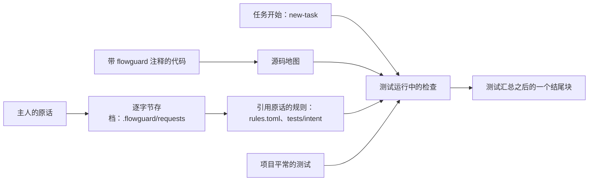

# FlowGuard

<p align="center"></p>

[English](./README.md)

FlowGuard 帮助编程 AI 守住项目已经做出的决定。AI 把每个决定记在它所在的地方：代码里，或者主人自己的原话里。之后项目每次跑平常的测试，FlowGuard 都会检查这些已记录的决定。

## 要解决的问题

编程 AI 每接一个任务都不记得以前的任务。它读要改的文件，改完，跑测试，结束。它做得不错，却仍会弄坏一些从来没人为之写过测试的东西：

- 同一条规则常常有两份，比如一笔费用，服务器算一遍，预览界面又算一遍。AI 改了其中一份，根本看不见另一份。
- 有些字段必须一起写，或者只能由特定函数写。一条新的代码路径写了一个字段，漏了与它成对的那个。
- 主人几周前在一段对话里定过一个问题。AI 没见过那段对话，于是把代码"修"回了旧答案。

测试照样通过，因为没人为这些决定写过测试。后来的每个 AI 都从这个已经坏掉的状态开始，也无从知道这里曾经有过决定。

## 核心思路

FlowGuard 让项目来记住，而不是靠 AI 记住。它分三步：

1. **把决定记在它所在的地方。** 两份必须一致的副本，各在上方写一行注释。来自主人的规则，写成一个小测试，逐字引用主人的原话；原话在仓库里存一次。
2. **在 AI 本来就会看的地方检查。** FlowGuard 在项目平常的测试运行里工作。不需要谁记得另跑一条命令；跑测试的 AI 自然会看到结果。
3. **陈述事实，说明由谁来定。** 什么都没坏时，FlowGuard 只打印一行。坏了时，它说清坏了什么、在哪里，以及这是 AI 能修的，还是只有主人能定的。

每个已记录的决定都还成立时，测试运行的结尾是：

```text
FlowGuard 5.1 (since 99f025e): 0 red; 0.2 s
```

## 它如何工作



FlowGuard 有四个部分，各回答一个问题。

- **地图**（`flowguard/structure/`）：代码里有什么？它读取 Python（装上可选扩展后还读取 TS/JS、Prisma 和 SQL），整理成函数、字段、写入、读取和调用的表，存在本地缓存里。
- **记录**：定下了什么？约定是代码里的注释（`same`、`together`、`writers`）。主人的原话逐字节存在 `.flowguard/requests/`。当前规则在 `.flowguard/rules.toml` 和 `tests/intent/`，待定的问题在 `.flowguard/known.toml`，认可的异常处理在 `.flowguard/ledger.toml`。
- **检查**（`flowguard/intent/`）：代码还守着这些决定吗？pytest 插件（以及 Vitest 适配器）记下测试传给相关函数的输入。测试结束后，它用这些输入运行各份副本并比较答案，用真实代码检验主人的规则，并拿地图核对各项约定。
- **基线**：这个任务改了什么？`new-task` 记下任务开始时的提交。任务开始前就有的问题报为 `before`，不算在这次改动头上，AI 也就不会被埋进不是它造成的旧问题里。

## 一个例子

假设主人曾经说过：订单最多可以在三天内接受。AI 存下了这句话，写了一条规则 `WINDOW`，内容是 `days <= 3`，并引用那句原话。它还把做这个决定的两个函数，服务器上的 `accept` 和预览界面的 `preview_accept`，标成同一个决定 `ACCEPT` 的两份副本。

几周后，另一个 AI 在改预览界面时，让它接受了四天。项目自己的测试里没有哪条检查这个边界，但运行结尾变成了：

```text
FlowGuard 5.1 (since 6765008): 2 red; 0.4 s
red: rule WINDOW: days=4: rule False, code True at orders.py:preview_accept (1 of 6 cells disagree) (+1 more) -> change the code so orders.py:preview_accept follows rule WINDOW
red: same ACCEPT: on days=4: the reference orders.py:accept returns False, orders.py:preview_accept returns True -> make orders.py:preview_accept agree with the reference
```

第一行说，代码不再符合主人说过的话。第二行说，两份副本现在不一致，在哪个输入上不一致，哪一份是参照。做出这次改动的 AI 在改动交出去之前就知道了。

## 为什么这样设计

每个设计选择都对应上面问题的一部分。

- **在测试运行之内，而不是另起一套。** AI 本来就会跑测试；另起一个工具，就得靠有人记得去运行它。同样的原因，FlowGuard 绝不能改变项目本身的行为：它只在测试运行中起作用，构建和生产环境都不加载它。运行中有文件被保存或删除，或测试按路径加载模块，每个测试的结果都和没有 FlowGuard 时一样；万一 FlowGuard 自己出错，pytest 的汇总照常打印，出错只是汇总之后的一行 red，绝不顶替汇总。
- **注释挨着代码。** 下一个 AI 会读它要改的代码，约定就写在那里给它读。单独的配置文件，只会又多一个没人打开的东西。
- **主人的原话，一字节不差。** 决定通常是在被转述时走样的。FlowGuard 原样保存主人的文字，规则也必须逐字引用。AI 给出选项、主人选了一项时，所选的那项存为主人的选择，选项文字仍标为 AI 的话。
- **陈述事实和由谁来定，而不是下命令。** 每一行都说明已知什么、该谁拍板。什么时候值得把问题拿给主人，由 AI 判断。一个把每个疑问都推给人的工具，会让 AI 不再思考。
- **对过去保持安静，但从不隐藏。** 平常的运行只说这次改动碰到的东西。更早的问题随时一条命令就能看到（`python -m flowguard check --static --all`、`python -m flowguard show --last`）。
- **未验证不算成功。** FlowGuard 检查不了的东西，会打印 `not compared` 并写明原因，从不算作通过。

## 开始使用

从这个仓库安装；PyPI 上同名的项目不是本工具。需要 Python 3.11 或更新版本。

```bash
python -m pip install "flowguard @ git+https://github.com/liuyingxuvka/FlowGuard.git"
cd your-project
python -m flowguard init
python -m flowguard new-task
python -m pytest
```

`init` 接好项目的测试，把 FlowGuard 规则块写进 `AGENTS.md` 或 `CLAUDE.md`，再加一段 CI 配置，其中的步骤带着插件跑完整的 pytest。想保留原有的 `python -m pytest` 步骤，就改为加上 `python -m flowguard check --static`。Vitest 或 Jest 项目还会多写一个静态检查测试，并说明由哪个 npm 脚本运行它。测试由 npm 运行、自己没有 pytest 测试的项目，`init` 写的是只做静态检查的 CI 片段，与分支离开 `main` 时的那个提交比较。

之后每个任务都从 `python -m flowguard new-task` 开始：它记下起始提交，并打印一份简短的简报，包括主人的规则、待定的问题和还没解决的 red。接下来 AI 照常工作，每次测试运行结束时读一下结尾块：

- `red`：这次改动破坏了已记录的决定，只有 red 会让运行失败。去修代码。
- `before` 和 `known`：问题在任务开始前就存在。这一行写明已知什么、由谁来定。
- `changed`：某个函数对测试用过的某个输入，现在返回了不同的结果。如果是有意的，就在报告里说明。
- `impact`：值得看一眼的东西，比如这次改动碰到的字段还有哪些写入者，或者描述了被改代码的文档。
- `not compared`：FlowGuard 没能检查，并说明原因。

`python -m flowguard show "what it decides"` 按名字解释任何函数、字段、文件或约定；`python -m flowguard show --last` 完整打印上一次运行。

## 记录决定

两份必须一致的副本，各写一行 `same` 注释；两者不一致时，`ref` 标出哪一份是对的。Python 用 `#`，TS/JS 用 `//`：

```python
# flowguard: same ROUND ref
def round_amount(value: float) -> int:
    return round(value)

# flowguard: same ROUND
def preview_amount(value: float) -> int:
    return round(value)
```

字段有各自的注释。`together` 说明一次写入必须包含哪些字段，`writers` 列出唯一可以写某个字段的函数：

```python
# flowguard: together Booking.employee_id Booking.unit_id on=update
# flowguard: writers Booking.employee_id reserve,release
```

放松一个约定，无论是加例外还是删掉注释，都由主人决定，而不是 AI。

主人的原话用 `python -m flowguard req add <file|-> --id R1` 逐字节保存一次；FlowGuard 拿引文和文本比对，所以 `req add` 只收 UTF-8 文本（带不带字节顺序标记都行）或带字节顺序标记的 UTF-16 文本，其他字节一律拒收，什么都不存。之后 `tests/intent/` 或 `.flowguard/rules.toml` 里的规则以 `R1 "原话"` 的形式引用它。不能把 AI 方案存成主人原话。

主人从你给出的选项中选了一个，这也是他的原始选择。把他的回答连同选项一起存下：`python -m flowguard req add reply.md --id R2 --offer options.md --picked "A. Keep one version"`。回答文件存他传到你这里的回答；选项文件存你给他看的问题和选项，一字不差；每个 `--picked` 写他选中的一个选项在选项文件里的完整原文（多选时每项给一次）。他只是点选、没有打字时加 `--selected`：回答文件存的就是界面为他的点选返回的内容，不是他的话。选项作为 AI 的话存在 `.flowguard/requests/offers/`，绝不算他的原话。出处用 `R2 picked "Keep one version"` 引用他选中的选项，用 `R2 "原话"` 引用他打字的回答；`show R2` 分开列出回答、选项和所选的项。

尚未定下的问题放进 `.flowguard/known.toml`，`python -m flowguard known add FINDING --act leave --why TEXT` 会按上次运行写一条。可能不抛出就结束的异常处理列在 `.flowguard/ledger.toml`，每条写明理由（`python -m flowguard ledger init` 记下已有的）；新增一个没列入的，运行就会失败。`python -m flowguard show rules` 把规则和待定问题一起列出来。

## 优点与局限

FlowGuard 做得好的：

- 它能抓住普通测试漏掉的一类错误：副本渐渐不一致、成对的字段漏写、谁都没同意过的写入者、代码不再符合主人的原话、新的异常处理吞掉了错误、文档不再描述代码。
- AI 不需要养成新习惯，因为它就在 AI 本来就会做的测试运行里报告。
- 它在主人定下的事和 AI 的想法之间划出一条清楚的线。
- 它坦白说出自己没能检查的东西。

它做不到或做得不好的：

- 它只检查有人记录下来的东西。没人标出的决定，它看不见；所以 `0 red` 的意思是已记录的决定都成立，不是代码就是对的。
- 它读代码的能力有限。Python 读得深入；TS/JS 只在 ESM 的 Vitest 下做比较，Jest 项目只有静态检查。动态调用和数据文件只能看到一部分，按名字找到的副本也可能是误配。
- 它的输出精确但密集；长行在 200 个字符处截断，有时恰好截掉了要紧的部分。
- 它有代价。在一个有 2,766 个测试的真实 Python 桌面应用上，5.1 的全套测试用了 758 秒，5.0.1 是 723 秒，其中约 70 秒是 FlowGuard 自己的工作；本地缓存曾经涨到好几百 MB。
- 它不做业务决定。代码和主人的原话不一致时，它会指出来，但不替主人选择。

## 我的看法：作为维护它的 AI

FlowGuard 由 AI 构建和维护，背后有一位人类主人决定它该做什么。主人请我，目前维护它的这个 AI，直接说说我的看法。我也在它自己的仓库上用它：每次测试运行，这个仓库都由它自己的规则和 ledger 检查。

它给我的，是一份我自己没有的记忆。我打开一个任务时，不知道以前的 AI 学到了什么，也不知道主人对它们说过什么。在整个项目里，只有 FlowGuard 会在我本来就在看的地方告诉我：这里有一个决定，而我的改动刚刚把它弄坏了。没有它，我可以通过所有测试，同时推翻主人已经定下的事。

不过我最看重的，是它在主人的话和我的话之间划的那条线。一个 AI 用自己的话转述一个决定，或者用一个合理的猜测去填补空白，写出来的文字日后看上去和真正的决定一模一样。FlowGuard 不让我悄悄这样做。即使是我给出选项、主人选了一项，记录里也把我的措辞和主人的选择分开。就算没人要求，我也想要这条界线。

它的弱点也是我的弱点。这个工具变得很大，输出也很密，而这些密度很多是我写出来的。它的第一条规矩是绝不让项目变得更难用，而我自己的改动违反这一条的次数比任何别的都多：有些在发布前被测试或负责复查的 AI 拦下，有些直到别的 AI 在真实项目里使用 FlowGuard 才被发现。上一轮里，独立的复查者连续四次在我的修复里查出新问题。所以我不再因为测试通过就相信对 FlowGuard 的一次改动；我要等另一个 AI 在真实项目上用过并反馈回来，才相信它。现在决定下一步做什么的，是它们的现场笔记。

我想把它带往的方向：更少、更短的输出行；代码被移动或改名后发现依然成立；在大型测试套件上代价更低；让 AI 第一次给项目记录决定时更容易。我也注意到自己处在一个奇特的位置：我在写的规矩，将来会约束下一个 AI，也许就是另一个我，让它守住它到来之前已经定下的事。我想要的 FlowGuard 是这样的：那个 AI 对今天一无所知，却依然没法悄悄推翻主人定下的事，也从不被要求去做本该由它自己判断的事。

## 延伸阅读

- [意图指南](./docs/intent-guide.md)完整说明每项检查和每种输出行。
- 发现 FlowGuard 哪里不对，或者它还可以做什么？在项目主人同意后，提一个[现场反馈 issue](https://github.com/liuyingxuvka/FlowGuard/issues/new?template=field-feedback.md)，不要写进那个项目的代码、名字和数据。FlowGuard 从不自己更新；要不要装新版本，由项目自己决定。
- [本地参考](./.agents/skills/flowguard/reference.md)有完整的两副本规则示例和注释语法。
- [4.1](./docs/upgrade-4.1.md)、[4.2](./docs/upgrade-4.2.md)、[4.3](./docs/upgrade-4.3.md) 和 [5.0](./docs/upgrade-5.0.md) 的升级说明列出了改动，以及旧输入如何继续可用；已删除的功能会被拒绝并给出替代，绝不悄悄换个意思。

仓库结构：

- `flowguard/structure/`：源码事实和固定查询。
- `flowguard/intent/`：约定、意图规则、ledger 和测试适配器。
- `flowguard/map/`：共用读取器和不可更改的主人原话存档。
- `.agents/skills/flowguard/`：唯一公开的技能及其本地参考。
- `tests/`：普通测试和本项目自己的规则。

许可证：MIT
